# 🎯 Fine-Tuning Large Language Models — Beginner to Advanced


> A practical, vendor-neutral guide to understanding **what fine-tuning is, which problems it solves, how its major methods differ, how to select tools, how to train and evaluate models, and how to operate them in production**. It moves from core concepts to implementation and advanced engineering trade-offs.

**Who is this for?** Software engineers, ML engineers, AI engineers, data scientists, solution architects, and developers building domain-specific LLM applications.

**Diagram note:** Diagrams use Mermaid with explicit class styles. GitHub renders these diagrams in the repository view. Mermaid colors can vary with the reader's GitHub theme, but the nodes remain labeled for accessibility.

---

## 🧭 Table of contents

- [1. What is fine-tuning?](#1-what-is-fine-tuning)
- [2. Why fine-tune? What problem does it solve?](#2-why-fine-tune-what-problem-does-it-solve)
- [3. When to fine-tune—and when not to](#3-when-to-fine-tuneand-when-not-to)
- [4. Prompting vs RAG vs fine-tuning](#4-prompting-vs-rag-vs-fine-tuning)
- [5. How a language model learns](#5-how-a-language-model-learns)
- [6. The end-to-end workflow](#6-the-end-to-end-workflow)
- [7. Data engineering for fine-tuning](#7-data-engineering-for-fine-tuning)
- [8. Main types and methods](#8-main-types-and-methods)
- [9. Supervised fine-tuning (SFT)](#9-supervised-fine-tuning-sft)
- [10. Continued pretraining](#10-continued-pretraining)
- [11. Preference optimization: DPO and RLHF](#11-preference-optimization-dpo-and-rlhf)
- [12. Full fine-tuning vs PEFT](#12-full-fine-tuning-vs-peft)
- [13. LoRA explained](#13-lora-explained)
- [14. QLoRA and quantized training](#14-qlora-and-quantized-training)
- [15. Other parameter-efficient methods](#15-other-parameter-efficient-methods)
- [16. Training objective, labels, and masking](#16-training-objective-labels-and-masking)
- [17. Hyperparameters and training stability](#17-hyperparameters-and-training-stability)
- [18. Libraries and frameworks: what to use when](#18-libraries-and-frameworks-what-to-use-when)
- [19. Python implementation walkthrough](#19-python-implementation-walkthrough)
- [20. C# implementation and integration perspective](#20-c-implementation-and-integration-perspective)
- [21. Compute, memory, and scaling](#21-compute-memory-and-scaling)
- [22. Evaluation and experiment design](#22-evaluation-and-experiment-design)
- [23. Common challenges and remedies](#23-common-challenges-and-remedies)
- [24. Deployment and operations](#24-deployment-and-operations)
- [25. Decision tree](#25-decision-tree)
- [26. Quizzes and exercises](#26-quizzes-and-exercises)
- [27. Glossary and cheat sheet](#27-glossary-and-cheat-sheet)
- [28. Tags](#28-tags)

---

## 1. What is fine-tuning?

**Fine-tuning is the process of taking a model that has already been pretrained and continuing its training on a targeted dataset so that its behavior becomes better suited to a particular task, domain, format, or preference.**

A pretrained language model has learned broad statistical patterns from large collections of data. Fine-tuning uses a smaller, more focused set of examples to adjust the model's parameters or a small set of additional parameters.

Examples:
- A general model learns to respond in a company's approved support style.
- A coding model learns internal code-review conventions from reviewed examples.
- A document model learns to produce a fixed JSON schema from invoices.
- A healthcare documentation assistant learns a constrained note-writing format using appropriately governed data.
- A model learns to classify support tickets into an organization's taxonomy.

Fine-tuning does **not** automatically make a model factually correct, up to date, safe, or capable of executing external actions. Those goals may require retrieval, tools, guardrails, evaluation, or application logic as well.

### The mental model

```mermaid
flowchart LR
    A["🧠 Pretrained model<br/>Broad capabilities"] --> B["📚 Curated examples<br/>Task or domain"]
    B --> C["⚙️ Training<br/>Optimize model"]
    C --> D["🎯 Adapted model<br/>Targeted behavior"]
    D --> E["🧪 Evaluation<br/>Check quality"]
    E --> F["🚀 Deployment<br/>Serve the model"]

    classDef model fill:#4F46E5,stroke:#312E81,color:#FFFFFF,stroke-width:2px;
    classDef data fill:#059669,stroke:#065F46,color:#FFFFFF,stroke-width:2px;
    classDef train fill:#F59E0B,stroke:#92400E,color:#111827,stroke-width:2px;
    classDef eval fill:#0891B2,stroke:#164E63,color:#FFFFFF,stroke-width:2px;
    classDef deploy fill:#DB2777,stroke:#831843,color:#FFFFFF,stroke-width:2px;
    class A,D model;
    class B data;
    class C train;
    class E eval;
    class F deploy;
```

### Important distinction

Fine-tuning changes model behavior through training. It is different from changing the prompt, adding documents to a retrieval system, or writing ordinary application code.

---

## 2. Why fine-tune? What problem does it solve?

A base model can often do many tasks but may not reliably follow one organization's conventions or a specialized output contract. Fine-tuning is useful when repeated examples can teach a behavior more reliably than complex prompting alone.

| Problem | Possible fine-tuning goal | What else might be needed |
|---|---|---|
| Inconsistent output format | Produce structured JSON or a fixed template | Schema validation and retries |
| Domain-specific language | Adopt domain terminology and task patterns | RAG for facts and documents |
| Repeated classification | Apply a stable label taxonomy | Calibrated thresholds and evaluation |
| Organization's response style | Match tone and response structure | Policy rules and content review |
| Repetitive extraction | Follow a task-specific extraction pattern | OCR, validation, and source traceability |
| Preference for one answer style | Prefer concise, helpful or ranked responses | Preference labels and human review |
| Specialized writing or code conventions | Follow examples of desired output | Tests, linters, and static analysis |

### What fine-tuning is not

- **Not a guaranteed knowledge update.** It may teach patterns about facts, but it is usually a poor substitute for a searchable source of frequently changing facts.
- **Not a substitute for retrieval.** A model cannot cite private documents that were never supplied at inference time unless relevant information was learned during training—and memorization is not a reliable document-retrieval design.
- **Not a substitute for deterministic code.** Use ordinary validation and business rules for exact constraints whenever possible.
- **Not a magic quality switch.** Results depend on base-model suitability, data quality, training setup, and evaluation.

---

## 3. When to fine-tune—and when not to

Fine-tuning is worth investigating when a task is repeated, success can be measured, and you can assemble representative examples of desired behavior.

Consider fine-tuning when:
- Prompt instructions have become long, brittle, or repetitive.
- A model must consistently follow a domain-specific format or rubric.
- You have many high-quality input/output examples.
- The behavior should be embedded in a reusable model rather than repeated in every prompt.
- You can evaluate the result against a baseline and a holdout dataset.

Avoid or defer it when:
- You have only a few poorly labeled examples.
- The real requirement is access to changing, private, or traceable facts.
- A prompt, tool call, schema, or simple code change already solves the problem.
- There is no evaluation strategy or no way to detect regressions.
- The base model's capability or license is unsuitable.
- Training and operational cost exceed the value of the improvement.

### A practical sequence

1. Establish a baseline with a representative test set.
2. Improve the prompt and output constraints.
3. Add RAG if current or private knowledge is the problem.
4. Fine-tune if a repeatable behavioral gap remains.
5. Combine methods when each solves a different part of the problem.

---

## 4. Prompting vs RAG vs fine-tuning

These are different levers and can be combined.

| Approach | Changes model weights? | Best suited for | Main limitation |
|---|---:|---|---|
| Prompt engineering | No | Instructions, context, examples, formatting | Long or fragile prompts; no learned update |
| RAG (retrieval-augmented generation) | No | Current/private facts, source-grounded answers | Retrieval quality and context window matter |
| Fine-tuning | Usually yes; PEFT updates a subset | Repeatable behavior, style, task patterns | Requires training data, compute, and evaluation |
| Tool use / application logic | No | Calculations, workflows, external actions, deterministic rules | Requires reliable tools and orchestration |
| Combined approach | Sometimes | Products with both knowledge and behavioral requirements | More components to test and operate |

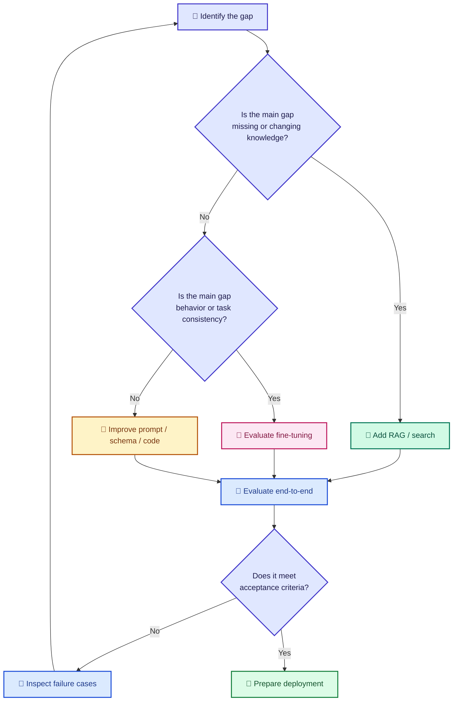

**Rule of thumb:** RAG supplies evidence; fine-tuning shapes behavior; prompts specify the immediate task; tools perform operations. These are complementary rather than mutually exclusive.

---

## 5. How a language model learns

### 5.1 Pretraining

During pretraining, a causal language model commonly learns to predict the next token in a sequence. Given a prefix, it estimates a probability distribution over the next token.

For a sequence x₁, x₂, …, xₜ, the next-token objective is commonly written:

$$
\\mathcal{L}_{next} = -\\sum_{t=1}^{T} \\log p_\\theta(x_t \\mid x_{<t})
$$

Here, θ represents model parameters and x<sub><t</sub> means the tokens before position t.

### 5.2 Fine-tuning

Fine-tuning uses the same or a related optimization process, but the training examples and objective are chosen for the desired behavior. In supervised fine-tuning, inputs provide context and target responses provide the tokens the model should learn to produce.

### 5.3 The training loop

```mermaid
flowchart LR
    A["📄 Example"] --> B["🔤 Tokenizer"]
    B --> C["🧩 Input IDs<br/>and labels"]
    C --> D["🤖 Forward pass"]
    D --> E["📉 Compute loss"]
    E --> F["🧮 Backpropagation"]
    F --> G["⚙️ Optimizer step"]
    G --> H{"More batches<br/>or epochs?"}
    H -->|Yes| D
    H -->|No| I["💾 Save checkpoint"]
    classDef data fill:#D1FAE5,stroke:#047857,color:#064E3B,stroke-width:2px;
    classDef model fill:#DBEAFE,stroke:#1D4ED8,color:#1E3A8A,stroke-width:2px;
    classDef math fill:#FEF3C7,stroke:#B45309,color:#78350F,stroke-width:2px;
    classDef end fill:#FCE7F3,stroke:#BE185D,color:#831843,stroke-width:2px;
    class A,B,C data;
    class D model;
    class E,F,G,H math;
    class I end;
```

A **batch** is a group of examples processed together. An **epoch** is one pass over the training dataset. A **checkpoint** is a saved model/training state.

### 5.4 Training, validation, and test sets

- **Training set:** used to update the model.
- **Validation set:** used during experimentation for checkpoint selection and hyperparameter decisions.
- **Test set:** held back for final, unbiased comparison.

Do not use the test set to repeatedly tune the model. Keep related examples—such as near-duplicates, multiple turns from the same conversation, or documents from the same source—in the same split where appropriate to limit leakage.

---

## 6. The end-to-end workflow

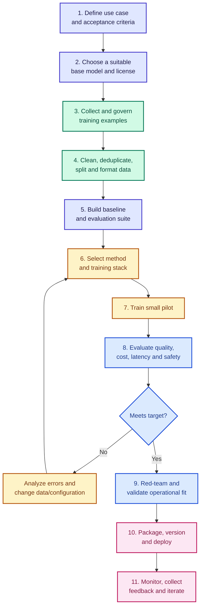

A common mistake is starting with training code before deciding what “better” means. Define quality, risk, latency, and cost targets before tuning.

---

## 7. Data engineering for fine-tuning

**High-quality, representative examples are usually more valuable than a larger volume of noisy examples.**

### 7.1 Sources of examples

- Human-authored demonstrations
- Expert-reviewed examples
- Approved historical interactions after privacy and policy review
- Synthetic examples generated from trusted seeds and filtered by validators or reviewers
- Preference pairs where reviewers choose the better response
- Domain-specific text for continued pretraining, where permitted

Do not assume generated data is correct merely because a powerful model produced it. Use provenance, checks, sampling, and human review.

### 7.2 Common supervised formats

Simple instruction/response record:

```json
{
  "instruction": "Summarize the incident.",
  "input": "The API returned 503 errors for 12 minutes.",
  "output": "The service experienced a 12-minute availability incident with HTTP 503 errors."
}
```

Conversational record (exact schema depends on the library):

```json
{
  "messages": [
    {"role": "user", "content": "Classify: payment failed after timeout."},
    {"role": "assistant", "content": "{\\"category\\":\\"payment\\",\\"severity\\":\\"medium\\"}"}
  ]
}
```

Preference data often pairs a prompt with a preferred (chosen) and less-preferred (rejected) response. Use the schema expected by the training framework.

### 7.3 Data quality checklist

- Are examples correct, legal to use, and policy-compliant?
- Do examples reflect production input distributions and edge cases?
- Are outputs consistent in style, labels, terminology, and schema?
- Are duplicates, near-duplicates, and train/test leakage controlled?
- Are personally identifiable and confidential details removed or governed appropriately?
- Are incorrect, harmful, ambiguous, or low-quality labels filtered?
- Are data splits reproducible and versioned?
- Does each record have provenance or a clear source category?

### 7.4 Data volume is not a universal threshold

There is no single number of examples that guarantees a successful fine-tune. Required volume depends on task complexity, base-model quality, label consistency, diversity, and the acceptable error rate. Begin with a pilot and learning curve: measure performance as the dataset grows.

---

## 8. Main types and methods

The word *fine-tuning* covers several training strategies. They are related, but they solve different problems.

| Method | Training signal | What changes | Typical use |
|---|---|---|---|
| Continued pretraining (CPT) | Raw or domain text, usually next-token prediction | Model parameters or adapters | Domain language, vocabulary, distribution adaptation |
| Supervised fine-tuning (SFT) | Demonstrations of desirable answers | Model parameters or adapters | Instruction following and task behavior |
| Instruction tuning | SFT examples written as instructions | Model parameters or adapters | General instruction-following behavior |
| Preference optimization (e.g., DPO) | Chosen/rejected answer pairs | Model parameters or adapters | Align response preferences |
| RLHF | Human preferences, reward model and reinforcement-learning optimization | Model parameters | Preference alignment through reward optimization |
| Full fine-tuning | Task-specific objective | Most/all model weights | Maximum flexibility when compute and governance permit |
| PEFT (e.g., LoRA) | Commonly SFT or preference objective | Small trainable parameter subset | Lower training memory/storage and adapter-based specialization |
| Distillation | Teacher outputs or targets | Student model parameters | Transfer behavior into a smaller/cheaper model |
| Multimodal fine-tuning | Task-specific paired modality examples | Selected model components | Image/text, audio/text, video or cross-modal behaviors |

### Training stages often form a pipeline


The sequence is illustrative, not mandatory. Many applications only need SFT; some use CPT before SFT, some use preference optimization afterwards, and some need no fine-tuning at all.

---

## 9. Supervised fine-tuning (SFT)

SFT teaches by demonstration: for a given context, the model is optimized to assign higher probability to the desired response tokens.

### Example

**Input:** “Rewrite this message professionally: send the file now.”

**Target output:** “Could you please send the file at your earliest convenience?”

The training process repeatedly presents the context and the target response. At inference time, the model generates an answer rather than receiving target labels.

### SFT data flow

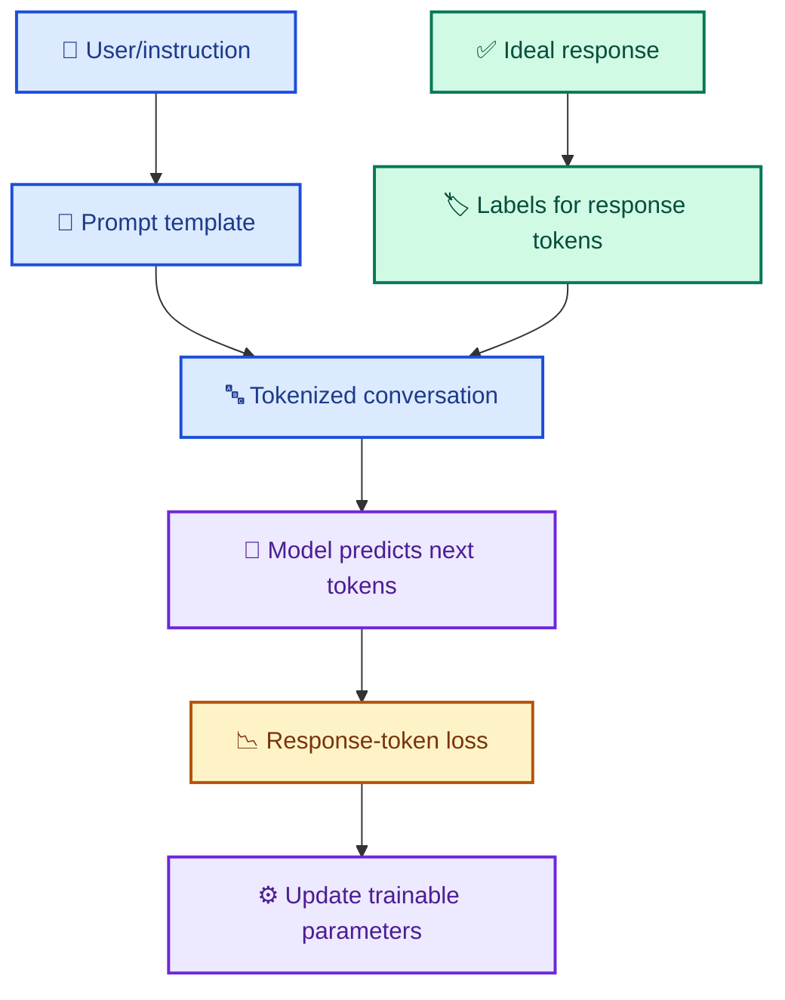

### Why prompt templates matter

Chat models often expect role markers, separators, and end-of-turn tokens. The exact chat template should match the chosen model and tokenizer. Inconsistently formatted training examples can make the model learn the wrong boundary between user context and assistant response.

### Single-turn and multi-turn examples

- **Single-turn examples** teach atomic instruction-following behaviors.
- **Multi-turn examples** teach use of context across turns, corrections, clarification, and conversational continuity.
- Both can be useful. Balance them according to the actual product behavior and keep evaluation splits representative.

---

## 10. Continued pretraining

Continued pretraining continues the model's broad language-modeling objective on a new text distribution, such as technical documents or domain-specific prose.

Use it when the gap is partly about domain language or distribution—not merely how the assistant should respond to instructions.

Potential benefits:
- Greater exposure to domain terminology and writing patterns.
- Better adaptation to a specialized text distribution.

Risks:
- Can overfit the domain corpus.
- Does not by itself teach reliable instruction-following output formats.
- May degrade previous abilities through **catastrophic forgetting**.
- Can learn low-quality, biased, private, or copyrighted material if data governance is weak.

Continued pretraining is often followed by SFT to teach the desired interaction pattern.

---

## 11. Preference optimization: DPO and RLHF

Sometimes multiple answers are plausible, but one is preferred for helpfulness, style, harmlessness, or task success. Preference optimization uses comparisons rather than only one “gold” answer per prompt.

### Preference pairs

A record may contain a prompt, a **chosen** response, and a **rejected** response. The chosen response should be demonstrably better according to clear reviewer criteria, not just different.

### DPO intuition

**Direct Preference Optimization (DPO)** trains a model directly on preference pairs and a reference policy, avoiding the classic separate reward-model-plus-RL optimization loop used in common RLHF pipelines. The objective compares how much the policy favors chosen responses over rejected responses relative to a reference model. The exact implementation and hyperparameters depend on the library.

### Typical preference pipeline

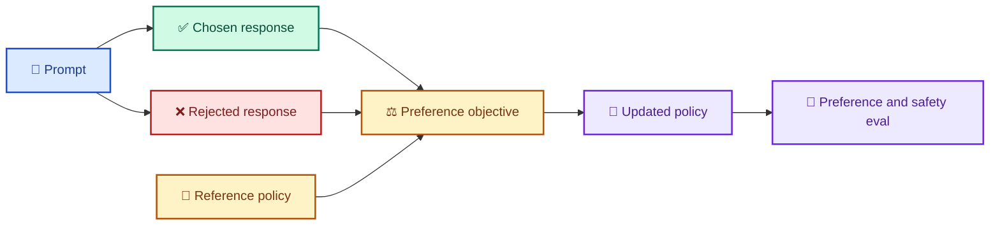

### DPO vs RLHF

| Dimension | DPO-style preference optimization | Classic RLHF pipeline |
|---|---|---|
| Preference signal | Chosen/rejected pairs | Human preference comparisons commonly train a reward model |
| Reward model | Not required as a separate model in standard DPO | Usually trained |
| Policy optimization | Direct preference objective | Often reinforcement learning such as PPO |
| Complexity | Often fewer moving parts | More components and tuning |
| Main challenges | Preference-data quality, reference-policy choice, objective tuning | Reward hacking, reward-model quality, optimization stability, compute |

Preference optimization cannot rescue inconsistent or misleading preference labels. Define a rubric, train annotators, inspect disagreement, and evaluate for unwanted trade-offs.

---

## 12. Full fine-tuning vs PEFT

### Full fine-tuning

Most or all pretrained model weights are trainable. It offers flexibility but can require substantial accelerator memory for parameters, gradients, optimizer states, and activations.

### Parameter-Efficient Fine-Tuning (PEFT)

PEFT methods freeze most pretrained weights and train a comparatively small set of parameters. PEFT is a **family of methods**, not a single technique.

| Dimension | Full fine-tuning | PEFT |
|---|---|---|
| Trainable parameters | Most/all weights | Small subset or added parameters |
| Training memory | Usually higher | Often lower |
| Adapter storage | Usually stores full model checkpoint | Can store small adapter separately |
| Multi-task specialization | Separate full checkpoints can be costly | Multiple adapters may be practical |
| Maximum flexibility | High | Depends on method and target modules |
| Operational complexity | Simpler conceptual weight layout | Adapter management/compatibility may be needed |

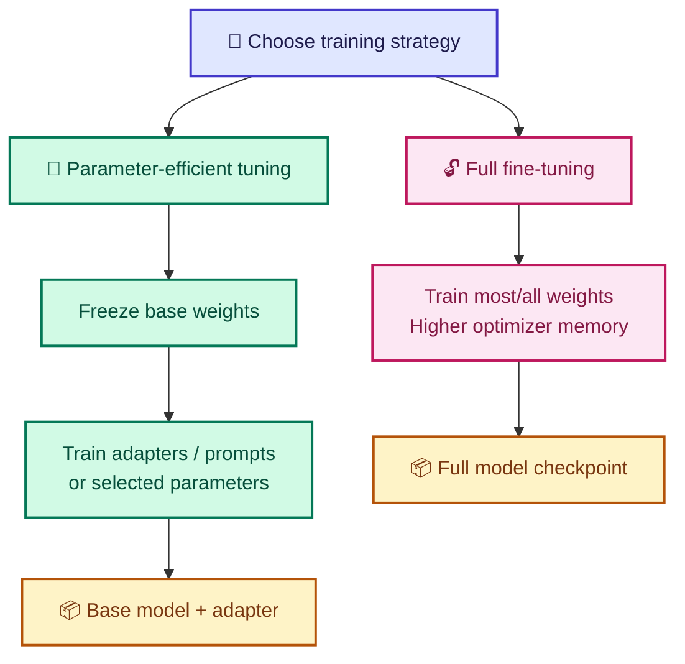

PEFT often makes experiments more accessible, but does not eliminate the need for representative data, evaluation, and enough memory to load the base model and process activations.

---

## 13. LoRA explained

**Low-Rank Adaptation (LoRA)** freezes an existing weight matrix and learns a low-rank update using two smaller matrices. It is widely used for PEFT.

Let the original weight matrix be W. LoRA expresses the adapted weight as:

$$
W' = W + \\Delta W, \\qquad \\Delta W = \\frac{\\alpha}{r}BA
$$

Here, A and B are trainable low-rank matrices, r is the rank, and α controls update scaling. Implementations may use different initialization/scaling variants; check the framework version and configuration.

### Visual intuition

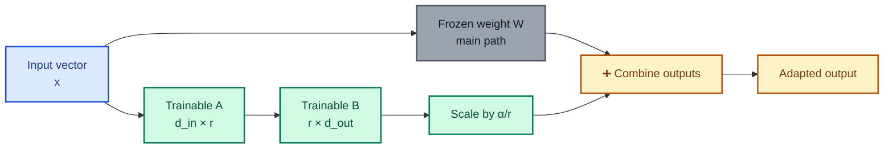

### Parameter count

For a single weight matrix W with input dimension d_in and output dimension d_out:

- Full matrix parameters: d_in × d_out
- LoRA parameters: r × d_in + d_out × r = r(d_in + d_out)

**Example:** for d_in = 4096, d_out = 4096, and r = 16:

- Full matrix: 4096 × 4096 = 16,777,216 parameters.
- LoRA: 16(4096 + 4096) = 131,072 parameters.
- LoRA introduces approximately **0.78%** as many parameters as that one full matrix. This is not the same as the percentage of parameters in the whole model.

```python
def lora_parameter_count(d_in: int, d_out: int, rank: int) -> int:
    if min(d_in, d_out, rank) <= 0:
        raise ValueError("Dimensions and rank must be positive.")
    return rank * (d_in + d_out)

print(lora_parameter_count(4096, 4096, 16))  # 131072
```

### Rank and target modules

- Higher rank increases adapter capacity and trainable parameter count.
- Lower rank reduces storage/compute but may not capture the desired update.
- Rank is not a direct quality knob; validate against held-out tasks.
- Target module names differ by architecture. Many transformer implementations expose names such as query/key/value/output projections and MLP projections, but inspect the actual model module tree rather than assuming names.
- Adapting attention-only layers may be insufficient for some tasks; MLP projections can matter as well.

### Important implementation details

- **Scaling:** a common LoRA scaling factor is α/r; some variants, including rank-stabilized LoRA, use another scaling rule.
- **Dropout:** adapter dropout may reduce overfitting; validate rather than enabling it blindly.
- **Initialization:** commonly one low-rank matrix is initialized so the initial update is zero; exact details depend on implementation.
- **Merge:** LoRA weights can often be merged into the base weights for inference, but compatibility and quantization details should be tested.
- **Adapter composition:** combining or switching adapters is framework- and serving-stack-dependent. Do not assume arbitrary adapters can be combined without quality testing.

---

## 14. QLoRA and quantized training

**QLoRA** popularized training LoRA adapters while keeping the base model in low-bit quantized form, reducing memory needs compared with full-precision base-weight training. A common configuration uses 4-bit quantization for the frozen base weights, with trainable LoRA parameters held in a suitable higher-precision format.

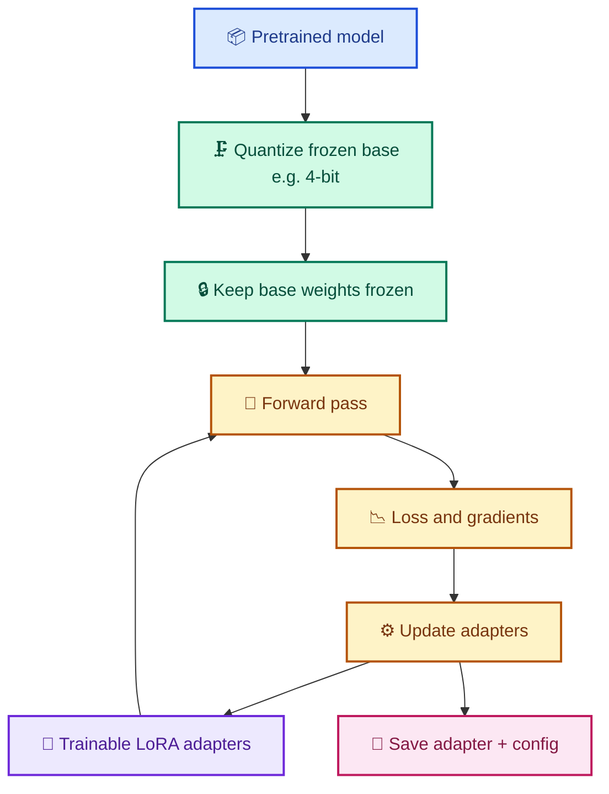

### What quantization does—and does not do

Quantization reduces the number of bits used to represent weights or activations. It can reduce memory and sometimes speed inference/training, depending on hardware and kernels. It introduces approximation and is not a guaranteed speed-up in every setup.

QLoRA does **not** mean all training state is 4-bit. Optimizer states, adapter weights, gradients, activations, temporary buffers, and framework overhead still consume memory.

Choose QLoRA when base-model loading and training memory are the main constraints and your hardware/software stack supports the needed quantization kernels. Benchmark actual peak memory and task quality.

---

## 15. Other parameter-efficient methods

| Method | Core idea | Useful when | Trade-off |
|---|---|---|---|
| **Adapters** | Add small trainable modules between model components | Separate task modules are operationally useful | Additional modules and sometimes latency |
| **Prefix tuning** | Learn continuous vectors used as virtual prefix/context in attention layers | Need a compact task-specific learned prefix | Can be sensitive to configuration and sequence behavior |
| **Prompt tuning** | Learn embeddings for virtual prompt tokens while freezing the model | Very parameter-efficient adaptation for supported model/task setups | May be less expressive or harder to optimize on smaller models |
| **P-tuning** | Learn continuous prompt representations, often with a prompt encoder | Prompt-based PEFT experiments | Setup and performance depend on architecture |
| **IA³** | Learn scaling vectors for selected internal activations | Very small parameter budget | Constrained form of adaptation |
| **DoRA** | Decompose weight direction and magnitude while adapting the weight | Investigating a LoRA-related adaptation variant | More complex than basic LoRA; implementation support varies |
| **BitFit** | Update selected bias terms | Small baseline or low-budget experiments | Limited adaptation capacity |
| **Selective layer tuning** | Unfreeze only certain layers/modules | When the most relevant layers are known and budget allows | Requires careful architecture-specific validation |

Do not choose a method purely based on a benchmark headline. Compare candidates with the same baseline, data splits, evaluation protocol, and deployment assumptions.

---

## 16. Training objective, labels, and masking

### 16.1 Causal language modeling

For next-token prediction, the model sees the preceding tokens and is trained to predict the next one. Training libraries often shift logits and labels internally; understand whether your framework expects already-shifted labels or performs shifting itself.

### 16.2 Loss masking in chat SFT

Many chat SFT recipes compute loss only on assistant response tokens, masking user messages, system instructions, and sometimes tool/context tokens with an ignore index. This prevents the model from being directly optimized to reproduce the prompt, while still conditioning on it.

The exact choice depends on the training objective. Some training recipes intentionally train on a broader set of tokens. Verify the collator and label construction.

### 16.3 Truncation and sequence length

If an example exceeds the maximum sequence length, truncation may remove important context or part of the target response. Monitor the percentage of examples truncated, whether target answers survive truncation, token length distribution, effective batch tokens per optimizer step, and padding waste.

### 16.4 Chat templates and special tokens

Use the base model's expected chat template and tokenization conventions. Avoid manually inventing role markers if the tokenizer has a defined template. When adding new special tokens, the embedding/output layers may need resizing and those parameters may require training.

---

## 17. Hyperparameters and training stability

| Hyperparameter | What it controls | Practical guidance |
|---|---|---|
| Learning rate | Size of optimizer updates | Tune against baseline; PEFT and full tuning often use different effective ranges |
| Epochs | Passes through the training examples | Watch validation and task-specific regression; more is not always better |
| Batch size | Examples/tokens processed per step | Account for memory, sequence length, gradient accumulation |
| Gradient accumulation | Combines multiple micro-batches before update | Raises effective batch size without holding the full batch in memory |
| Warmup | Gradually increases learning rate at training start | Can improve early stability |
| Weight decay | Regularizes parameter updates for optimizers that support it | Configuration depends on method and parameter groups |
| Dropout | Randomly disables some activations during training | Can help overfitting but may not be needed |
| Max sequence length | Token context size used for training examples | Longer sequences can sharply increase activation memory |
| LoRA rank | Adapter capacity | Compare several reasonable ranks on a validation set |
| LoRA alpha | Scaling parameter in common LoRA formulations | Interpret together with rank and variant |
| Precision | Numerical format for operations | BF16/FP16/FP32 support varies; test stability on target hardware |
| Scheduler | Changes learning rate over the run | Pick one intentionally and record its configuration |

### Watch more than training loss

- **Training loss down, validation loss up:** likely overfitting.
- **Both losses flat and behavior poor:** possibly data/configuration/optimization issue or a weak base model.
- **Loss improves but product metrics do not:** objective and evaluation may not match real task quality.
- **Quality drops after more epochs:** consider an earlier checkpoint, lower learning rate, data cleanup, regularization, or fewer updates.
- **Model becomes repetitive:** inspect data duplication, excessive training, decoding configuration, and task diversity.

No one learning rate or epoch count is right for all model sizes, task types, datasets, optimizers, or training frameworks.

---

## 18. Libraries and frameworks: what to use when

The ecosystem evolves quickly. Verify the current documentation and pin compatible versions before running a training job.

### Core libraries

| Library | Main purpose | Choose it when |
|---|---|---|
| [PyTorch](https://pytorch.org/) | Tensor/autograd and deep-learning training foundation | Need direct control over model and training loop |
| [Transformers](https://huggingface.co/docs/transformers) | Model/tokenizer loading, trainer utilities and model ecosystem | Training a supported Hugging Face model |
| [Datasets](https://huggingface.co/docs/datasets) | Dataset loading, mapping, transformation and caching | Preparing repeatable datasets |
| [PEFT](https://huggingface.co/docs/peft) | LoRA, prompt tuning and other parameter-efficient methods | Freezing most base weights and training adapters |
| [TRL](https://huggingface.co/docs/trl) | Trainer recipes for SFT and preference methods such as DPO | Instruction tuning or preference-optimization workflows |
| [Accelerate](https://huggingface.co/docs/accelerate) | Device placement and distributed-training abstraction | Moving from single-device experiments to multi-GPU setups |
| [bitsandbytes](https://huggingface.co/docs/bitsandbytes) | Quantized model operations and optimizer components | Supported low-bit loading/QLoRA workflows |
| [DeepSpeed](https://www.deepspeed.ai/) | Distributed optimization and memory/runtime strategies | Large-scale training and distributed memory management |
| [torchtune](https://pytorch.org/torchtune/) | PyTorch-native LLM fine-tuning recipes | PyTorch-oriented recipe customization |
| [LlamaFactory](https://github.com/hiyouga/LLaMA-Factory) | Config-driven model fine-tuning workflows | Want an accessible UI/config-driven training workflow |
| [Axolotl](https://github.com/axolotl-ai-cloud/axolotl) | Configuration-driven fine-tuning pipeline | Need reproducible recipes and broad model/PEFT options |
| [Unsloth](https://github.com/unslothai/unsloth) | Optimized training paths for supported models/hardware | Want to try optimized LoRA/QLoRA recipes after checking support |

### Which stack should I use?

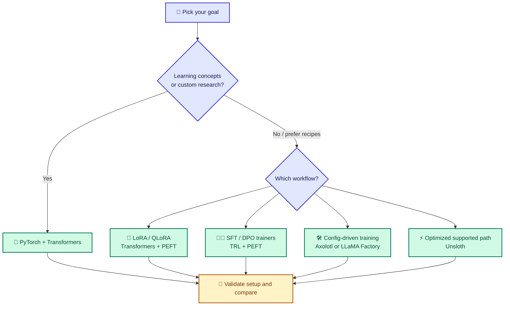

**Practical starter recommendation:** for an educational SFT/LoRA experiment, begin with Transformers + Datasets + PEFT. Add TRL when its trainer matches your objective. Add Accelerate/DeepSpeed only when needed. Or use a recipe framework if you prefer configuration over code. Keep Python package versions pinned because APIs change.

### Model-provider APIs

Some hosted providers offer managed fine-tuning for supported models. They can reduce infrastructure work but constrain model choice, method, observability, data residency, and portability. Check the provider's current model eligibility, data policy, pricing, and supported objective before committing.

---

## 19. Python implementation walkthrough

These snippets illustrate the workflow. **They are templates, not a promise that identical code works with every model or library version.** Validate current library APIs, model support, GPU compatibility, tokenizer templates, and dataset schema.

### 19.1 Install a common Hugging Face stack

```bash
pip install torch transformers datasets peft trl accelerate
```

For 4-bit QLoRA, you may additionally need a compatible `bitsandbytes` build and supported CUDA/platform setup. Consult the current official documentation rather than assuming every operating system or GPU is supported.

### 19.2 Prepare a tiny JSONL dataset

Create `train.jsonl` with one JSON record per line:

```json
{"messages":[{"role":"user","content":"Rewrite professionally: send it now"},{"role":"assistant","content":"Could you please send it at your earliest convenience?"}]}
{"messages":[{"role":"user","content":"Rewrite professionally: fix this today"},{"role":"assistant","content":"Could you please prioritize resolving this today?"}]}
```

This tiny sample is for understanding schema only; it is **not sufficient to train a useful general model**.

### 19.3 A trainer-based SFT skeleton

The following pattern uses TRL's `SFTTrainer` and a conversational `messages` dataset. Dataset and argument names have changed across releases, so compare this with the documentation for your pinned TRL version.

```python
from datasets import load_dataset
from transformers import AutoModelForCausalLM, AutoTokenizer
from peft import LoraConfig
from trl import SFTConfig, SFTTrainer

model_id = "Qwen/Qwen2.5-0.5B-Instruct"  # Example only; confirm license/availability.
dataset = load_dataset("json", data_files={"train": "train.jsonl"})

tokenizer = AutoTokenizer.from_pretrained(model_id)
model = AutoModelForCausalLM.from_pretrained(model_id)

if tokenizer.pad_token is None:
    tokenizer.pad_token = tokenizer.eos_token

peft_config = LoraConfig(
    task_type="CAUSAL_LM",
    r=16,
    lora_alpha=32,
    lora_dropout=0.05,
    bias="none",
    # Inspect model.named_modules() and choose supported targets for this model.
    target_modules=["q_proj", "v_proj"],
)

training_args = SFTConfig(
    output_dir="./fine-tuned-output",
    num_train_epochs=1,
    per_device_train_batch_size=1,
    gradient_accumulation_steps=4,
    learning_rate=2e-4,
    logging_steps=5,
    save_strategy="epoch",
    # For conversational datasets, use the configured template/collator and
    # enable assistant-only loss only if supported and intended by your version.
)

trainer = SFTTrainer(
    model=model,
    args=training_args,
    train_dataset=dataset["train"],
    processing_class=tokenizer,
    peft_config=peft_config,
)

trainer.train()
trainer.save_model("./fine-tuned-output")
tokenizer.save_pretrained("./fine-tuned-output")
```

**Before running:** inspect the selected model's actual module names; ensure the chosen target modules exist; verify that `messages` is accepted by your trainer version and that the model's chat template is being applied; configure assistant-only loss masking if desired and supported; add a validation dataset; and confirm license, privacy, hardware, and package compatibility.

### 19.4 Inspect LoRA parameters and shapes

PEFT typically injects `lora_A` and `lora_B` modules into selected layers. The dimensions depend on the layer's input/output sizes, chosen rank, adapter key, and implementation.

```python
def describe_lora_modules(model):
    report = {}
    for name, module in model.named_modules():
        if not hasattr(module, "lora_A") or not hasattr(module, "lora_B"):
            continue
        if len(module.lora_A) == 0 or len(module.lora_B) == 0:
            continue

        adapter_name = next(iter(module.lora_A.keys()))
        if adapter_name not in module.lora_B:
            continue

        a = module.lora_A[adapter_name].weight
        b = module.lora_B[adapter_name].weight
        short_name = name.rsplit(".", 1)[-1]
        report.setdefault(short_name, {
            "lora_A_shape": list(a.shape),
            "lora_B_shape": list(b.shape),
        })
    return report
```

Repeated modules with the same short name are grouped by the first occurrence in this compact report; for architecture analysis, preserve full module names and inspect all layer instances.

### 19.5 Estimate trainable-parameter reduction

```python
def lora_trainable_reduction(
    base_params: int,
    target_modules: list[list[int]],
    r: int,
    num_layers: int,
) -> float:
    """Estimate parameter-count reduction vs. the base parameter count.

    Each [d_in, d_out] describes one adapted matrix in one block.
    Excludes biases, embeddings, heads, other trainable weights, and runtime state.
    """
    if base_params <= 0 or r <= 0 or num_layers <= 0:
        raise ValueError("base_params, r, and num_layers must be positive")

    trainable_total = num_layers * sum(
        r * (d_in + d_out)
        for d_in, d_out in target_modules
    )
    if trainable_total > base_params:
        raise ValueError("Estimated trainable parameters exceed base parameter count")

    return round(100 * (base_params - trainable_total) / base_params, 4)
```

Use exact module dimensions and account for architecture-specific layers when you need a reliable total.

---

## 20. C# implementation and integration perspective

Most current open-source LLM fine-tuning recipes run in Python because the training ecosystem for Transformers, PEFT, quantization, and distributed GPU workloads is concentrated there. C# is highly useful for **serving, application integration, orchestration, evaluation harnesses, and business workflows**.

Typical architecture:
1. Train or adapt a model with a supported Python training stack.
2. Version the base model, adapter, tokenizer, chat template, training data manifest, and evaluation results.
3. Serve the model in a compatible inference runtime.
4. Integrate it with .NET using HTTP/gRPC or a compatible provider/runtime SDK.
5. Add output validation, tracing, security controls, and operational metrics.

Possible .NET-side building blocks include `HttpClient`, ASP.NET Core, Microsoft.Extensions.AI, and Semantic Kernel for application integration; actual compatibility depends on the selected model-serving endpoint and SDK version. ONNX Runtime and local model runtimes can be appropriate for supported model formats, but they are not drop-in replacements for every transformer or adapter configuration.

### C# LoRA parameter arithmetic

```csharp
using System;

public static class LoraMath
{
    public static long CountTrainableParameters(
        int inputDimension,
        int outputDimension,
        int rank)
    {
        if (inputDimension <= 0 || outputDimension <= 0 || rank <= 0)
            throw new ArgumentOutOfRangeException(
                nameof(rank), "Dimensions and rank must be positive.");

        return (long)rank * (inputDimension + outputDimension);
    }

    public static void Main()
    {
        long count = CountTrainableParameters(4096, 4096, 16);
        Console.WriteLine(count); // 131072
    }
}
```

This is a calculation example, not a complete C# model-training implementation.

---

## 21. Compute, memory, and scaling

Training memory is not just the size of model weights. Depending on the training method, the major contributors include frozen base-model weights, trainable parameters, gradients, optimizer states, forward activations retained for backpropagation, temporary kernels/workspaces and communication buffers, and padding and sequence-length effects.

### Ways to manage memory

| Technique | Main effect | Watch-outs |
|---|---|---|
| LoRA/PEFT | Reduces trainable parameters and optimizer state | Base weights and activations still cost memory |
| Quantized base weights | Reduces base-weight storage | Requires compatible kernels; quality and latency must be measured |
| Gradient accumulation | Emulates a larger batch via micro-batches | Does not necessarily improve throughput |
| Gradient checkpointing | Trades extra recomputation for less saved activation memory | Can slow training |
| Mixed precision | Reduces numerical storage and can improve throughput | Hardware support and numerical stability vary |
| FlashAttention or optimized attention kernels | Reduces attention memory traffic and may improve speed | Availability depends on model, hardware, and software |
| Sequence-length control | Shortens processing and activation cost | Truncation can remove required context/answers |
| Distributed training/sharding | Distributes memory and/or computation | Networking and configuration complexity |

### A simple throughput model

Training time is roughly proportional to the number of training tokens multiplied by effective compute per token, divided by sustained useful compute throughput. Real runs also incur data loading, evaluation, checkpoint writing, communication, warmup, padding, and kernel overhead. Estimate with a short representative pilot rather than relying on peak accelerator FLOPs.

Record GPU model and memory; model revision and quantization; trainable parameter count; sequence length and effective batch size; tokens per second and total wall-clock time; peak GPU memory and CPU/RAM use; loss curves and evaluation results; and cost per successful task, not only cost per token.

---

## 22. Evaluation and experiment design

Evaluation should answer two questions: **Did the target behavior improve?** and **Did anything important get worse?**

### 22.1 Evaluate before and after

Keep an untouched test set and compare the base model, prompt-engineered baseline, RAG baseline (when relevant), fine-tuned candidate, and fine-tuned candidate plus production guardrails/tools where applicable.

### 22.2 Match metrics to the task

| Task | Possible metrics |
|---|---|
| Classification | Accuracy, precision, recall, F1, confusion matrix, calibration |
| Structured extraction | Exact match, field-level F1, schema-valid rate |
| Summarization | Human rubric, factual consistency, coverage; automated metrics as supporting evidence |
| Code generation | Unit-test pass rate, static analysis, security checks |
| Retrieval-grounded answers | Retrieval recall, citation precision, claim support, answer correctness |
| Preference alignment | Pairwise preference win rate, rubric scores, safety metrics |
| Latency-sensitive use | p50/p95 latency, throughput, memory, cost per request |

LLM-as-judge can help scale evaluation, but judge bias, position bias, style preference, and agreement with human judgment should be measured. Use blinded comparisons where practical and have humans review important decisions.

### 22.3 Regression and contamination checks

Test target-task performance, general ability regression, instruction adherence and formatting, hallucination and unsupported claims, prompt injection and harmful requests relevant to the product, data memorization and privacy leakage risks, long-input and malformed-input behavior, and distribution shift and rare edge cases.

### 22.4 Track reproducibility

For every run, store the base model ID and immutable revision; dataset version and split manifest; code commit and package lock/version manifest; complete training configuration and random seeds where applicable; checkpoint/adapter identifier; evaluation data and metrics; known limitations, approvals, and rollback criteria.

---

## 23. Common challenges and remedies

| Symptom | Likely causes to investigate | Useful responses |
|---|---|---|
| Overfitting | Too many updates, duplicated data, narrow coverage | Improve diversity, fewer updates, regularization, early checkpointing |
| Underfitting | Weak base model, low capacity, noisy objective, too few useful updates | Inspect examples, increase capacity where justified, tune optimization |
| Catastrophic forgetting | Domain-only training shifts general behavior | Mix representative data, lower update magnitude, test regressions, use adapters |
| Hallucinations continue | Task does not provide evidence or target encourages unsupported answers | RAG, citations, abstention behavior, evidence-based evaluation |
| JSON is invalid | Inconsistent targets, weak format training, no runtime validation | Consistent examples, constrained decoding/schema validation |
| Training instability | Learning rate, precision, batch shape, optimizer, data issue | Reduce complexity, inspect gradient/loss behavior, test precision options |
| OOM | Model, activations, optimizer state, sequence length | Smaller batch/sequence length, PEFT, quantization, checkpointing |
| High latency | Large model, adapter/runtime overhead, inefficient serving | Profile, batch, optimize kernels, consider compatible merging or smaller model |
| Quality varies by prompt | Dataset coverage gaps, template mismatch, brittle behavior | Add diverse examples, verify chat template, challenge-test |
| Good loss, poor task metric | Misaligned objective/metrics, leakage or label problems | Evaluate product outcomes directly and inspect errors |
| Data leakage/privacy risk | Poor lineage, split contamination, sensitive records | Governance, minimization, de-identification, access control and audits |
| Adapter doesn't load | Wrong base revision, target modules, adapter config or library format | Pin versions/revisions and run a reproducible load test |

Treat troubleshooting as hypothesis testing: change one or a small number of variables at a time, run reproducible experiments, and preserve the prior best checkpoint.

---

## 24. Deployment and operations

A training checkpoint is not a production system. The deployed artifact must include the right weights, tokenizer, template, configuration, runtime requirements, and operational controls.

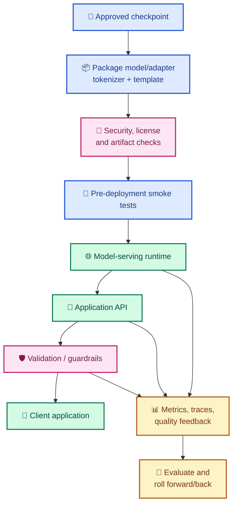

### Deployment checklist

- Confirm the base model revision and adapter compatibility.
- Verify tokenizer, special tokens, and chat template.
- Decide whether to serve base + adapter or a validated merged artifact.
- Test cold start, normal latency, concurrency, and peak memory.
- Apply access control and avoid logging sensitive prompts unnecessarily.
- Version prompts, retrieval indexes, adapters, evaluation suites, and serving configuration.
- Add observability for latency, errors, token use, refusal rates, schema errors, and user feedback.
- Create rollback criteria and retain a known-good artifact.
- Review model license, training-data rights, privacy, safety, and applicable regulatory obligations.

### Fine-tune or retrain?

Retrain when new representative examples or product requirements justify a new model version, when measured performance has shifted, or when an upstream base model must be replaced. Do not automatically retrain from every live interaction. Filter feedback, review privacy, label it carefully, test for poisoning, and use an explicit data/version approval process.

---

## 25. Decision tree

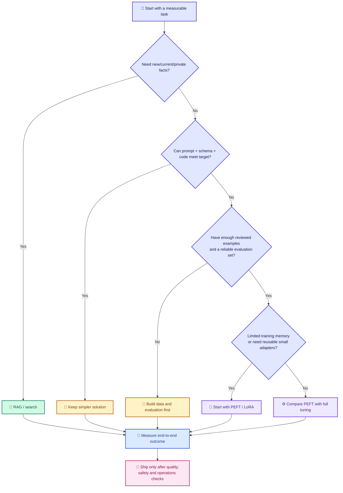

---

## 26. Quizzes and exercises

### Quiz 1 — Fine-tuning or RAG?

An assistant must answer questions about policy documents that change every week and cite the source paragraphs. What should you usually evaluate first?

<details>
<summary><strong>Reveal answer</strong></summary>

Use retrieval/search (RAG) to provide fresh source evidence and citations. Fine-tuning may still help the response style or task behavior, but it is not a dependable replacement for retrieving current documents.

</details>

### Quiz 2 — What does LoRA reduce?

<details>
<summary><strong>Reveal answer</strong></summary>

LoRA reduces the number of trainable parameters by learning low-rank update matrices. It does not necessarily reduce the base model's parameter count, and activations and runtime memory still matter.

</details>

### Quiz 3 — Calculate LoRA parameters

A matrix has d_in = 2048, d_out = 4096, and rank r = 8. How many trainable LoRA parameters are introduced for that matrix?

<details>
<summary><strong>Reveal answer</strong></summary>

8 × (2048 + 4096) = 8 × 6144 = **49,152** parameters.

</details>

### Quiz 4 — Training loss drops while validation quality gets worse

What is a likely explanation and what should you investigate?

<details>
<summary><strong>Reveal answer</strong></summary>

Overfitting is one possibility. Check data duplication, dataset size/diversity, number of updates, learning rate, validation split quality, and earlier checkpoints. Also verify that the evaluation metric reflects the actual task.

</details>

### Quiz 5 — Why does the chat template matter?

<details>
<summary><strong>Reveal answer</strong></summary>

It defines the role markers and special tokens the model expects. A mismatch between training format and inference format can degrade turn-taking, response boundaries, and instruction following.

</details>

### Hands-on exercises

1. **Baseline:** create 50–100 representative test cases, categorize them, and evaluate the base model with fixed prompts.
2. **Data quality:** make a small reviewed SFT set, remove duplicates, split it, and document data provenance.
3. **LoRA:** inspect model modules, select supported targets, calculate trainable parameters, and compare two ranks.
4. **Ablation:** compare prompt-only, RAG, SFT-LoRA, and SFT-LoRA + RAG on the same held-out cases.
5. **Operations:** version the adapter and tokenizer/template, run a load test, and write a rollback plan.

---

## 27. Glossary and cheat sheet

| Term | Meaning |
|---|---|
| Base / pretrained model | Model before task-specific adaptation |
| Fine-tuning | Continued training for targeted behavior or distribution |
| SFT | Supervised fine-tuning using target demonstrations |
| CPT | Continued pretraining on additional text |
| RLHF | Reinforcement Learning from Human Feedback |
| DPO | Direct Preference Optimization |
| PEFT | Parameter-Efficient Fine-Tuning |
| LoRA | Low-Rank Adaptation using trainable low-rank matrices |
| QLoRA | LoRA training with a quantized frozen base model in a common formulation |
| Rank | Low-rank dimension of LoRA update matrices |
| Alpha | Scaling hyperparameter used in common LoRA formulations |
| Tokenizer | Maps text to token IDs and back |
| Chat template | Serializes chat turns into the model's expected token format |
| Loss masking | Excludes selected tokens from the training objective |
| Epoch | One pass over the training data |
| Learning rate | Controls the scale of optimizer updates |
| Catastrophic forgetting | Losing prior capabilities while adapting |
| Data leakage | Evaluation information inadvertently influences training/tuning |
| Adapter | Small separately stored set of trainable adaptation parameters |
| Quantization | Represents values at lower numerical precision/bit width |

### Quick decision cheat sheet

- **Need current facts and citations?** Start with retrieval.
- **Need fixed output structure?** Try schema-constrained output and validation first.
- **Need repeatable behavior/style?** Build SFT data and evaluate fine-tuning.
- **Need preference alignment?** Consider DPO/RLHF with carefully reviewed preference data.
- **Limited GPU memory?** Evaluate LoRA/QLoRA and sequence/memory optimizations.
- **Need multi-task adapters?** PEFT may make versioning and specialization easier.
- **Need reliable production quality?** Measure, red-team, monitor, and keep rollback capability.

---

## 28. Tags

`Fine-Tuning` · `LLM` · `Generative AI` · `AI Engineering` · `Machine Learning` · `Deep Learning` · `Transformers` · `SFT` · `Instruction Tuning` · `Continued Pretraining` · `RLHF` · `DPO` · `PEFT` · `LoRA` · `QLoRA` · `DoRA` · `Hugging Face` · `Transformers Library` · `TRL` · `PyTorch` · `Quantization` · `Model Evaluation` · `LLM Deployment` · `Python` · `CSharp` · `GitHub` · `Mermaid Diagrams`

---

## References and further learning

Use the official documentation for the exact model, library versions, and supported training configuration you plan to use.

- [Hugging Face Transformers](https://huggingface.co/docs/transformers)
- [Hugging Face PEFT](https://huggingface.co/docs/peft)
- [Hugging Face TRL](https://huggingface.co/docs/trl)
- [Hugging Face Datasets](https://huggingface.co/docs/datasets)
- [Hugging Face Accelerate](https://huggingface.co/docs/accelerate)
- [bitsandbytes documentation](https://huggingface.co/docs/bitsandbytes)
- [PyTorch](https://pytorch.org/docs/stable/index.html)
- [DeepSpeed](https://www.deepspeed.ai/)
- [torchtune](https://pytorch.org/torchtune/)
- [LoRA paper: Low-Rank Adaptation of Large Language Models](https://arxiv.org/abs/2106.09685)
- [QLoRA paper: Efficient Finetuning of Quantized LLMs](https://arxiv.org/abs/2305.14314)
- [DPO paper: Direct Preference Optimization](https://arxiv.org/abs/2305.18290)

---

<div align="center">

**Learn the concepts. Build a baseline. Train carefully. Evaluate honestly. Deploy responsibly.**

[⬅️ Back to Awesome AI Engineer](./README.md)

</div>